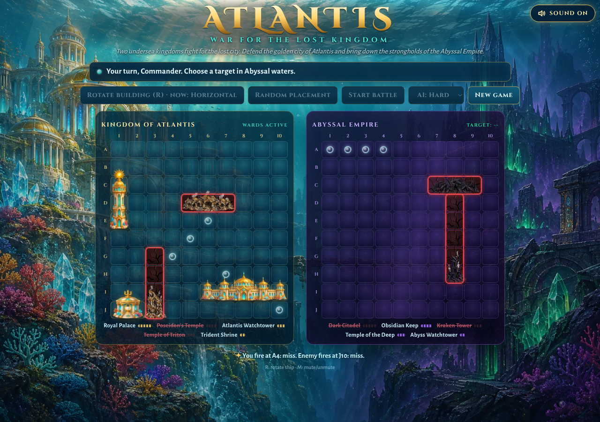

# Atlantis: War for the Lost Kingdom

A fantasy take on Battleship played in the browser against an AI. Place five fortresses (lengths 5, 4, 3, 3, 2) horizontally or vertically, then take turns attacking the Abyssal Empire's hidden strongholds.

**Play:** https://goethalssj-creator.github.io/battleship-devin-challenge/

- Easy AI fires at random. Hard AI targets the most likely positions.
- Painted underwater kingdoms; destroyed fortresses collapse into permanent ruins.
- Original synthesized music and sound effects. Audio starts on first interaction, and the mute button or the **M** key turns it off.
- Works on desktop and mobile.

**Controls:** click your board to place fortresses, press **R** (or the Rotate button) to rotate, then click enemy waters to attack.

## Files
- `index.html` + `assets/`: the game.
- `atlantis_standalone.html`: a single file with all images embedded; double-click to play offline.
- `BUGS.md`: bug report and QA summary.
- `tests/test_game.py`: Playwright test suite. Run `python3 serve.py`, then `python3 tests/test_game.py`.

All artwork and audio are original to this project.

